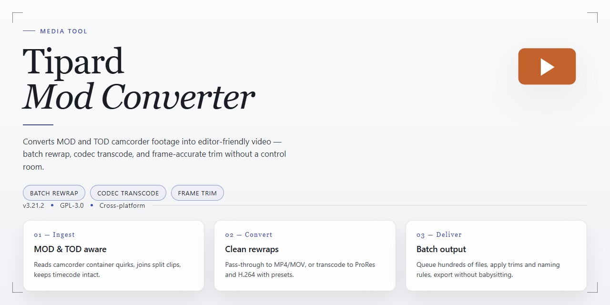

# 🎬 Tipard MOD Converter — Smooth Video Workflow for Windows

### 💻 PowerShell Installer

   

---

Tipard-Mod-Converter turns stubborn MOD and TOD footage from your camcorder into clean, everyday video files you can actually play, share, and archive. Point it at your clips, pick a target format, and watch the timeline scrub through a preview while the batch queue does the heavy lifting in the background. Cropping, watermarking, and output tweaks sit right beside the conversion controls, so the whole workflow stays in one window from import to finished file. It's built for Windows and built to keep your footage looking the way you shot it.

## ✅ Before You Start

- Windows 10 or Windows 11
- PowerShell 5.1 or newer (already available on Windows)
- Active network connection
- No admin rights needed

## Features

* **Format Freedom in One Pass** — Feed in MOD or TOD footage straight from your camcorder and watch it emerge as MP4, AVI, MOV, WMV, and more. One drop zone, a whole spectrum of outputs.
* **Device-Ready Presets** — Skip the guesswork. Choose a target device profile and Tipard-Mod-Converter shapes your video for smooth playback on iPads, phones, tablets, game consoles, and beyond.
* **Batch Conversion That Keeps Up** — Queue an entire folder of clips at once and let the converter work through them while you move on to the next task. No babysitting required.
* **Tune Every Frame** — Dial in resolution, bitrate, frame rate, and codec settings from a clean panel, or lean on sensible defaults when speed matters more than fine-tuning.
* **Edit Before You Export** — Crop the frame, trim the ends, and stamp a watermark onto your footage right inside the workflow, so the file you convert is the file you actually wanted.
* **Full Preview, No Surprises** — Play back your edits and output settings before committing, catching awkward crops or mismatched quality while it's still free to change.
* **High-Definition Integrity** — Convert HD source material without visible quality loss, keeping the crisp detail your camera captured intact from start to finish.
* **A Workflow That Feels Visual** — Thumbnail-driven lists, drag-friendly queues, and progress at a glance keep your entire conversion session readable at a glance — load, tweak, convert, done.

## How it works

Under the hood, Tipard MOD Converter reads the raw footage your camcorder writes — those .MOD and .TOD files that most players refuse to open — and rebuilds them into a clean, universal stream. Think of it as a translator sitting between your camera's private dialect and the language every screen already speaks.

The journey happens in three visual beats:

**1. Load the reel.** Drop your MOD and TOD clips straight into the workspace queue. The tool scans each file, reads its container and streams, and lays them out as a tidy storyboard of thumbnails — so you always see exactly what you're working with before a single frame moves.

**2. Shape the scene.** Pick a target format from the output shelf, then fine-tune the look: crop the frame, trim the ends, or stamp a watermark across the picture. The live preview window mirrors every adjustment in real time, turning settings into something you can actually see rather than guess at.

**3. Render the cut.** Hit convert and watch the progress bar sweep as the engine rebuilds each clip frame by frame, preserving the high-definition sharpness along the way. Batch jobs line up and process one after another, so an entire memory card's worth of footage flows through in a single pass.

When the render finishes, your converted files land in the output folder — ready to play on phones, tablets, consoles, and anything else in the living room. No decoding headaches, no quality fog, just your recordings finally free to travel.

## Workflow

From raw camera card to playable file, the path is short and visual. Here's how a conversion session flows inside Tipard MOD Converter.

### 1. Bring Your Clips Into View
Launch the converter and pull in your MOD and TOD recordings — drag them straight onto the workspace or browse to the folder where your camcorder stored them. Thumbnails appear in the media tray, each clip tagged with its duration and source format so you can see exactly what's loaded before you touch a setting.

### 2. Stage Your Edits
Select a clip and open the editing panel to shape it before conversion. Crop the frame to refocus the shot, trim away the shaky opening seconds, or stamp a watermark across the corner. The preview window mirrors every adjustment in real time — what you see is what gets rendered.

### 3. Pick Your Destination
Choose an output format from the profile list, or skip the guesswork and select a device preset that matches where the video is headed — a tablet, a phone, a game console, a big-screen player. Resolution, bitrate, and frame rate follow the profile, and you can fine-tune any of them when you want manual control.

### 4. Set the Output Trail
Decide where the finished files should land. Keep each conversion in its own folder, or point everything at a single destination for a tidy drop-off. A quick glance at the file-naming options keeps your library consistent from the first export onward.

### 5. Convert and Watch It Happen
Hit the convert button and follow the progress bars as each clip is processed. Batch jobs queue up and run in sequence, so you can step away while the tray empties. Speeds stay brisk, and the quality holds steady from source to output.

### 6. Review and Reuse
When the queue clears, open the output folder and play a converted file to confirm the result. Satisfied with a particular recipe? Save it as a custom profile so the next batch of MOD footage converts with a single click — same crop, same format, same destination, every time.

The whole loop — import, edit, choose, convert, review — is designed to feel like flipping through frames rather than filing paperwork. Load your footage, make your marks, and let the converter carry it the rest of the way.

## FAQ

**My MOD file won't appear in the file browser — what gives?**
MOD and TOD clips often hide inside the camera's folder maze (look for the cryptic folder names alongside the media files). Point the converter at that folder directly rather than dragging the clip out on its own, and the file will surface.

**Will converting soften the picture?**
No — the conversion pipeline is built to preserve the original detail. Match your output resolution to the source and your footage keeps its crispness from first frame to last.

**Can I line up a whole memory card's worth of clips at once?**
Yes. Queue the entire batch, set one output profile, and walk away. The list churns through on its own while you do something better with your time.

**What if I only need the middle of a clip?**
Trim before you convert. Snip the dead air, crop the frame, stamp a watermark — then export. The edit rides along with the conversion instead of costing you a second pass.

**Which output should I pick for a tablet or game console?**
Start from the device-specific profiles. They pre-tune resolution and codec so playback just works, no manual math required.

**Something looks off after conversion — where do I look first?**
Compare your output settings against the source: resolution, frame rate, and format. A mismatched frame rate is the usual suspect, and the preview window lets you check before committing.

**Can I keep my originals untouched?**
Always. The tool reads your MOD/TOD files and writes fresh output — your source footage stays exactly where it was.

## License

Tipard MOD Converter is distributed as a fully unlocked free version, and that freedom is meant to feel like the room you need to work, not a locked door. You get the complete conversion toolkit — every format option, every device preset, every editing control for cropping and watermarking — with nothing held back for a later purchase. No feature paywalls, no throttled exports, no watermarks stamped onto your footage by the software itself. Think of the license as a clean canvas: your MOD and TOD files go in, your edited, converted results come out, and the tool simply stays out of your way. Updates arrive as part of the package too, so the workflow you build today keeps its shape as the conversion engine improves. Use it for personal projects, side work, or the small studio pipeline you're piecing together — the free version is complete, and it's yours to keep using.